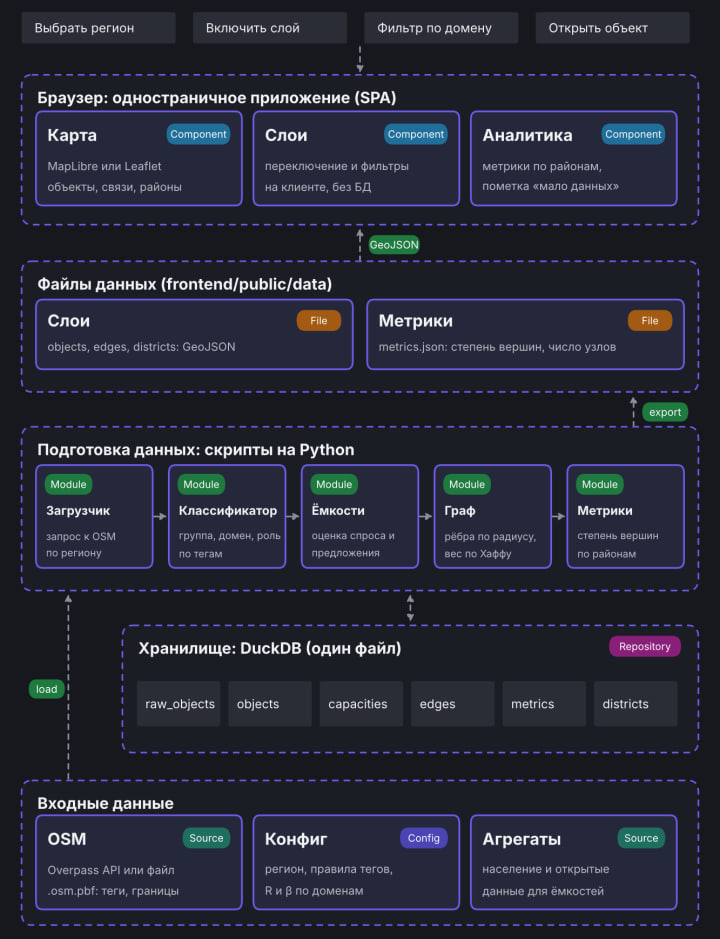

# Сервис анализа экономической активности региона

*Архитектура прототипа*

## 1. Назначение и границы

Сервис строит граф экономической активности региона по данным OpenStreetMap и показывает его на карте. Вершины графа — экономические субъекты (населённые пункты, банки, работодатели), рёбра — связи спроса и предложения внутри домена. Для каждого района и региона считается средняя степень вершины.

Документ описывает архитектуру прототипа. Цель прототипа — рабочий сквозной сценарий: выбрать регион, загрузить данные, получить граф и увидеть его в браузере. Промышленные требования (авторизация, масштабирование, много пользователей) в границы прототипа не входят.

### Домены

| Домен | Статус   | Состав                                                          |
|-----------|--------------|---------------------------------------------------------------------|
| money     | используется | Спрос: населённые пункты. Предложение: банки и банкоматы.           |
| labor     | используется | Спрос: работодатели. Предложение: населённые пункты (рабочая сила). |
| goods     | отключён     | Магазины и услуги.                                                  |

## 2. Архитектурные принципы

- Интерфейс находится на верхнем уровне. Всё, что видит аналитик, определяет остальные части, а не наоборот.
- Подготовка данных и показ разделены. Скрипты на Python готовят данные заранее, браузер только читает готовые файлы.
- Отдельного сервера и REST API нет. Интерфейс и данные связаны через статические файлы GeoJSON и JSON.
- DuckDB служит единой рабочей базой конвейера. Модули обмениваются данными через её таблицы.
- Источник данных — OpenStreetMap. Классификация объектов задаётся правилами по тегам в конфиге, а не кодом.
- Регион задаётся конфигом. Запуск для другого региона не требует изменения кода.
- Управление слоями не связано с базой данных. Включение и фильтрация слоёв происходят в браузере.

## 3. Общая схема



## 4. Компоненты

### 4.1. Интерфейс (SPA)

| Компонент | Задача                                                                                                                                           | Технологии                                           |
|---------------|------------------------------------------------------------------------------------------------------------------------------------------------------|----------------------------------------------------------|
| Карта         | Показывает объекты, связи и районы. Точки раскрашиваются по группе, толщина линий соответствует весу связи, районы закрашиваются по средней степени. | MapLibre или Leaflet, React, TypeScript, Vite            |
| Слои          | Включение и выключение слоёв, фильтр по домену и роли, выбор региона из подготовленных.                                                              | Состояние на клиенте, конфигурация слоёв в коде или JSON |
| Аналитика     | Таблица метрик по районам и региону, пометка «мало данных», карточка выбранного объекта.                                                             | Чтение metrics.json                                      |

### 4.2. Подготовка данных

| Модуль    | Задача                                                                                                                                                 | Вход и выход                                                |
|---------------|------------------------------------------------------------------------------------------------------------------------------------------------------------|-----------------------------------------------------------------|
| Загрузчик     | Запрашивает у OSM объекты региона по набору тегов и границы районов. Основной способ — Overpass API, запасной — файл .osm.pbf, разобранный через QuackOSM. | Вход: регион из конфига. Выход: таблицы raw_objects и districts |
| Классификатор | Определяет группу, домен и роль объекта по тегам. Правила хранятся в конфиге и применяются по порядку, побеждает первое подошедшее.                        | Вход: raw_objects. Выход: objects                               |
| Ёмкости       | Оценивает ёмкость спроса и предложения по косвенным признакам: население, площадь здания, число объектов поблизости.                                       | Вход: objects. Выход: capacities                                |
| Граф          | Строит рёбра между стороной спроса и стороной предложения в пределах радиуса R и считает вес по модели Хаффа.                                              | Вход: objects, capacities. Выход: edges                         |
| Метрики       | Считает степень вершин, среднюю степень по районам и региону, ставит флаг «мало данных».                                                                   | Вход: edges, objects, districts. Выход: metrics                 |
| Экспорт       | Записывает слои и метрики в файлы для интерфейса.                                                                                                          | Вход: таблицы DuckDB. Выход: GeoJSON и metrics.json             |

### 4.3. Хранилище (DuckDB)

Один файл базы без отдельного сервера. Используется расширение spatial для геофункций. Все модули подготовки читают и пишут таблицы в этом файле. Каждый модуль пересоздаёт свои таблицы целиком, поэтому повторный запуск даёт тот же результат на тех же входных данных.

| Таблица | Содержимое                                                                                    |
|-------------|---------------------------------------------------------------------------------------------------|
| raw_objects | Всё, что выгружено из OSM, как есть: идентификатор объекта, тип, координаты, теги целиком (JSON). |
| objects     | Классифицированные объекты без дублей: группа, домен, роль, название, координаты.                 |
| capacities  | Ёмкость и роль объекта в каждом домене.                                                           |
| edges       | Рёбра: домен, от кого и к кому, расстояние, вес (доля спроса по Хаффу).                           |
| districts   | Районы: название и полигон границы.                                                               |
| metrics     | Число узлов и рёбер, средняя степень, флаг «мало данных» по районам и региону.                    |

Подробная схема таблиц и полей приведена в документе schema.md.

### 4.4. Входные данные

- OpenStreetMap: объекты по тегам и административные границы районов. Данные распространяются по лицензии ODbL, при показе нужно указывать авторов.
- Конфиг региона (config/region.yaml): регион, правила тегов, радиус R и параметр β для каждого домена, порог «мало данных».
- Открытые агрегированные данные (Росстат и другие): население и показатели для оценки ёмкостей. Состав источников уточняется.

## 5. Поток данных

Весь сценарий запускается для одного региона, который указан в конфиге.

1. Загрузчик запрашивает у OSM объекты региона и границы районов и записывает их в DuckDB.
2. Классификатор присваивает каждому объекту группу, домен и роль по правилам тегов.
3. Модуль ёмкостей оценивает спрос и предложение по косвенным признакам.
4. Модуль графа строит рёбра внутри радиуса R и считает вес по формуле Хаффа.
5. Модуль метрик считает среднюю степень по районам и региону.
6. Экспорт записывает слои GeoJSON и metrics.json в папку frontend/public/data.
7. Интерфейс при открытии читает эти файлы через fetch и рисует карту. Переключение слоёв и фильтры работают на клиенте без обращения к базе.

Первая версия визуализации использует только шаги 1 и 2: на карте показываются классифицированные объекты. Рёбра и метрики подключаются по мере готовности модулей.

## 6. Модель связей

Вес ребра считается по модели Хаффа. Он равен доле спроса узла i, которая достаётся объекту j:

```
w(i, j) = S_j · d_ij^(−β) / Σ_k ( S_k · d_ik^(−β) )
```

- S_j — ёмкость объекта со стороны предложения, d_ij — расстояние между объектами.
- Ребро строится, только если расстояние не больше радиуса R. Сумма идёт по объектам внутри этого радиуса.
- Для каждого узла со стороны спроса веса исходящих рёбер дают в сумме 1.
- R и β задаются для каждого домена в конфиге.

Средняя степень района равна сумме степеней его узлов, делённой на число узлов. Ребро учитывается в степени обоих концов. Если в районе меньше узлов, чем порог в конфиге, метрика помечается как ненадёжная.

## 7. Технологический стек

| Часть         | Технологии                                              |
|-------------------|-------------------------------------------------------------|
| Интерфейс         | React, TypeScript, Vite; карта на Leaflet или MapLibre      |
| Подготовка данных | Python; DuckDB с расширением spatial; shapely для геометрии |
| Источники OSM     | Overpass API; запасной вариант — файлы Geofabrik и QuackOSM |
| Формат обмена     | GeoJSON и JSON                                              |
| Конфигурация      | YAML                                                        |
