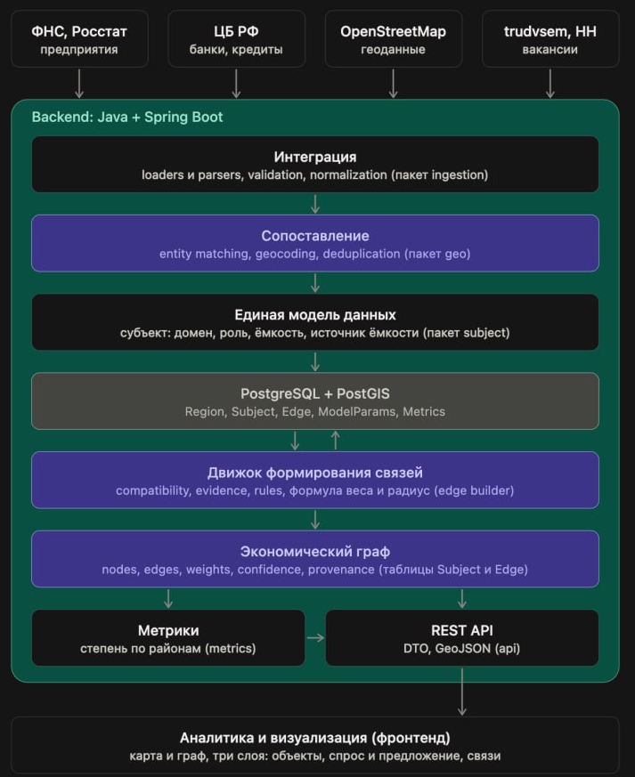

# Сервис анализа экономической активности региона: рабочие заметки

## Общая информация
Мы делаем инструмент аналитики, который по косвенным признакам восстанавливает граф экономической активности региона и показывает его на карте.
- Строится пространственно-экономический граф на основе разнородных данных.
- Старт с одного конкретного региона, но решение должно масштабироваться на другие.
- Предмет технического согласования: архитектура сбора и хранения данных, единая модель субъектов и ёмкостей, алгоритм построения потенциальных связей, API для визуализации.

## Ключевые определения
- **Предметная модель** - субъекты, спрос, предложение и показатели ёмкости.
- **Модель отношений** - подтверждённые и потенциальные связи между субъектами.
- **Графовая модель** - представление выбранных отношений в виде вершин и рёбер для анализа.

| Термин | Определение |
|--------|-------------|
| Субъект | Узел графа: объект региона, который формирует спрос или предложение (банк, завод, работодатель, населённый пункт) |
| Домен | Один из трёх экономических рынков: деньги, труд, товары и услуги |
| Спрос / Предложение | Роль субъекта в конкретном домене |
| Ёмкость | Размер предложения или спроса узла (посадочные места, число вакансий, число жителей). Чаще всего оценивается косвенно |
| Связь (ребро) | Подтверждённое отношение или рассчитанная потенциальная возможность взаимодействия |

## Экономические субъекты (узлы графа)
Два вида узлов: объекты, привязанные к точке, и население, агрегированное по населённому пункту (территории).  
Каждый узел хранит:
- домен
- роль (спрос или предложение)
- ёмкость
- источник ёмкости
- координаты
- район
- источник данных
- внешний идентификатор

## Ёмкость: как оценивать по косвенным признакам
Прямых данных о ёмкости почти нет, поэтому для каждого домена выбирается косвенный признак, и это допущение фиксируется явно. Для каждого узла храним, откуда взята ёмкость, и уровень доверия к ней.

| Что оцениваем | Прокси | Надёжность |
|---------------|--------|------------|
| Магазины и услуги (предложение) | Площадь контура здания из OSM, тег `capacity`, если есть; запасной вариант: типичный размер по типу объекта или сети | Средняя |
| Банки (предложение) | Число банкоматов и отделений рядом, тип отделения. Объёмы кредитов ЦБ даёт только по региону | Низкая |
| Компании (спрос на труд) | Число вакансий у работодателя по trudvsem и HH | Высокая |
| Население (предложение труда, спрос на деньги и товары) | Численность жителей населённого пункта или района | Высокая |

## Связи (рёбра) и вес ребра
Гравитационная модель (идея модели Хаффа): ребро соединяет узел спроса и узел предложения одного домена, если расстояние не больше радиуса досягаемости.  
Но не любая пара узлов вообще связана. Вводят порог: ребро создаётся, только если `d_ij ≤ R` (радиус).

$$
w_{ij} = \frac{C_i^{\text{спрос}} \cdot C_j^{\text{предл}}}{d_{ij}^{\beta}}
$$

где:

- $C_i$ и $C_j$ - ёмкости узлов;
- $d_{ij}$ - расстояние между ними;
- $\beta$ - параметр «чувствительности к расстоянию» (чем больше, тем быстрее связь затухает).

## Источники данных для парсинга

| Домен | Что берём | Источник | Ограничения |
|-------|-----------|----------|-------------|
| Деньги | Банки и банкоматы с координатами | OpenStreetMap через Overpass API, библиотека OSMnx | Нет ёмкости, неполное покрытие вне крупных городов |
| Деньги | Проверка, что банк настоящий | Справочник ЦБ РФ | Названия в OSM пишутся по-разному, нужен нечёткий матчинг |
| Труд | Вакансии: работодатель, зарплата, адрес, часто координаты | API trudvsem.ru | Координаты есть не всегда, нужно геокодирование; пауза не менее 1 секунды между запросами |
| Труд | Дополнение по вакансиям, профессиональные роли | API HeadHunter (OAuth 2.0) | Не более 2000 вакансий на регион, нет данных об образовании |
| Труд и спрос населения | Численность населения по муниципалитетам | Росстат, ЕМИСС | Часто только на уровне муниципальных образований, не населённых пунктов |
| Товары и услуги | Магазины, производства, услуги (`shop=*`, `industrial=*`, `leisure=*`, `craft=*`) | OpenStreetMap | Около 67% салонов красоты в данных Белгородской области без названия; ёмкость заполнена редко |
| Все | Границы региона, районов, населённых пунктов | OpenStreetMap (`admin_level`, `place=*`), ОКТМО | Качество границ различается по регионам |
| Все | Адрес в координаты и обратно | Nominatim | Не чаще 1 запроса в секунду, нестабильность |

## Архитектура приложения
Приложение реализуется как модульный монолит. Модули имеют чёткие границы ответственности и взаимодействуют через определённые интерфейсы. PostgreSQL/PostGIS служит общим постоянным хранилищем. Правила доступа модулей к данным и границы транзакций требуют согласования. Граф и метрики считаются заранее и сохраняются в базу (тяжелое вычисление и сбор, быстрое отображение), а API только читает готовое.

PostgreSQL с PostGIS — это единственный стык между сбором данных и построением графа. Остальные модули общаются через интерфейсы.

### Пакеты
| Пакет | За что отвечает |
|-------|-----------------|
| `ingestion` | Парсеры источников, очистка, геокодирование |
| `geo` | Регионы, районы, загрузка карты, привязка объекта к району |
| `subject` | Сущность субъекта, оценка ёмкости |
| `graph` | Построение рёбер, расчёт метрик |
| `api` | Контроллеры и DTO для фронтенда |
| `config` | Параметры модели по доменам (радиус) |
| `common` | Интерфейсы-контракты и утилиты |

Три домена реализуются как разные реализации двух интерфейсов, а общий сервис построения рёбер один: `SubjectSource` получает субъектов из источника, `CapacityEstimator` оценивает их ёмкость. Новый домен или регион добавляется новым классом без правки остального кода.

### Данные
| Сущность | Основные поля |
|----------|---------------|
| `Region` | `id`, `name`, `geometry` (полигон), `parent_id` (регион и районы в одной таблице) |
| `Subject` | `id`, `name`, `domain`, `role` (SUPPLY или DEMAND), `location` (точка), `district_id`, `capacity`, `capacity_source`, `source`, `external_id` |
| `Edge` | `id`, `supply_id`, `demand_id`, `domain`, `distance_km`, `weight`, `type` (потенциальная связь или точная) |
| `ModelParams` | `domain`, `radius_km`, `beta` |
| `DistrictMetrics` | `district_id`, `domain`, `avg_degree`, `node_count` |

Схема версионируется миграциями (Flyway). Пара `source` и `external_id` защищает от дублей при повторной загрузке.

## API для фронтенда
- `GET /api/regions` и `GET /api/regions/{id}/districts`: регионы и районы с геометрией (GeoJSON).
- `GET /api/subjects?region=&domain=`: слой статических объектов.
- `GET /api/graph?region=&domain=`: узлы и рёбра для слоёв спроса и предложения и связей.
- `GET /api/districts/{id}/metrics`: метрики района.
- `GET /api/subjects/{id}`: карточка объекта и его связи.

Формат ответа графа нужно зафиксировать с фронтендом до начала реализации. GeoJSON удобен для географических объектов, но для графа с большим количеством рёбер может оказаться избыточным. Можно использовать GeoJSON для карты и отдельный JSON-контракт для узлов и рёбер.

## Предварительные архитектурные решения

| Решение | Почему | Альтернатива | Примечания |
|---------|--------|--------------|-----------|
| Модульный монолит | Один деплой | Микросервисы: избыточно | Выбор ради простоты разработки |
| PostgreSQL + PostGIS | Пространственные запросы и индексы из коробки | Координаты числами: геометрию придётся писать руками | Исходя из необходимости хранения пространственной информации |
| Граф считается заранее | Быстрый API, тяжёлая работа отделена | На лету: медленно на большом регионе | |
| Параметры модели в базе или конфиге | Радиус и β меняются без пересборки, можно показать чувствительность | Хардкод: неудобно экспериментировать | |
| Интерфейсы источников и ёмкости | Новый домен или регион без переписывания кода | Ветвление по домену по всему коду | |
| Граф в таблицах базы | Хватает для региона, меньше инфраструктуры | Графовая БД: лишняя сложность на старте | |

## Важные вопросы
### 1. Как лучше спроектировать единую модель данных?
Достаточно ли сущностей `Subject`, `Edge`, или лучше отдельно представить участие субъекта в домене и его ёмкости? Как избежать дублирования одного предприятия, если оно участвует в нескольких доменах? 

**Варианты:**
- Можно отдельно моделировать участие субъекта в домене и его емкость в контексте этого домента (добавить новые таблицы в БД), не избыточно ли?
---

### 2. Какую модель формирования связей разумно реализовать первой?  
Достаточно ли для MVP пространственного порога и функции веса?

**Варианты:**
- Для начала можно использовать более простой подсчет весов, цель именно создавать корректные связи с корректными весами
---

### 3. Достаточно ли PostgreSQL + PostGIS для хранения и анализа графа? 
Стоит ли хранить рёбра обычными таблицами и рассчитывать метрики программно, или есть основания использовать отдельную графовую БД?

**Варианты:**
- Выбор графовой СУБД можно обосновать самой структурой данных для проекта, но вопрос насколько это будет удобно, ведь большая часть работы будет состоять именно в сборе информации из разнородных источников, а графовая структура представляется как цель для MVP. Также удобнее пространственные операции и привязку объектов к территориям выполнять средствами PostGIS, а построение графа - в прикладном модуле.
---

### 4. Как организовать обработку и сопоставление данных из разных источников?
Стоит ли хранить исходные записи отдельно от нормализованных субъектов? 

**Варианты:**
- Сохранять полученные записи в отдельном слое исходных данных, а уже затем выполнять нормализацию и т.д. При этом сохранять связь между исходной записью и обработанным субъектом.
---

### 5. Какой объём функциональности взять в MVP?
Лучше сначала полноценно реализовать один домен с проверяемой моделью связей или сразу строить все три домена на упрощённых правилах? Какие компоненты архитектуры стоит реализовать сразу, а какие оставить точками расширения?

**Варианты:**
- По словами заказчика проекта, лучше проработать один домен, по крайней мере в рамках одного домена наладить структуру, подсчет связей
---

### 6. Как лучше организовать API для карты и графа?  
Достаточно ли отдельных эндпоинтов для объектов, рёбер и метрик?

**Варианты:**
- Предварительные эдппоинты указаны выше в главе "API для фронтенда". Для начала этого будет достаточно, но необходимо согласовать формат ответов
---